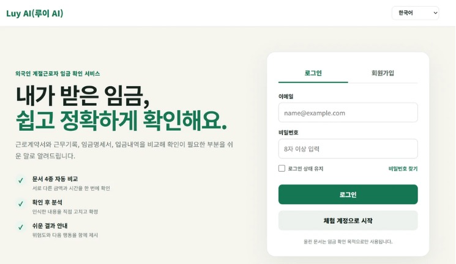

# Luy AI (루이 AI)

외국인 계절근로자의 **근로계약서 · 근무기록부 · 임금명세서 · 입금내역**을 연결해 문서 간 차이와 추가 확인이 필요한 부분을 안내하는 AI 서비스 프로젝트입니다.

`OCR` · `Human-in-the-loop` · `Rule Engine` · `Legal RAG` · `LLM`

## 핵심 흐름

문서 4종 업로드 → OCR 추출값 확인·수정 → 급여 거래 선택 → 규칙 기반 교차검증 → 공식 근거 조회 → 쉬운 설명 생성

판정은 규칙 엔진이 담당하고, LLM은 판정과 근거를 바탕으로 설명을 생성하도록 역할을 분리했습니다.

## 담당 역할 — 김영진

합성데이터 제작, 법령 API 기반 코퍼스 구축, 규칙과 법령 검색 연계, GPT 기반 불일치 설명 구현, R02·R03 허용오차 및 필요 피처 정의를 담당했습니다.

## 공개 자료 안내

이 저장소에는 서비스 소개, 아키텍처·흐름도·OCR 예시 이미지가 공개되어 있습니다. 아래 기능과 검증 결과는 프로젝트 문서에 기록된 내용이며, 실행 코드·의존성 파일·평가 원본은 현재 이 저장소에 포함되어 있지 않습니다.

- [서비스 소개 및 검증 기록](docs/PROJECT.md)
- [UI 및 아키텍처 이미지](docs/images/)

## 문서에서 확인할 수 있는 내용

- R00~R11 문서 교차검증 규칙과 판정 상태
- OCR·Legal RAG·LLM·UI 구성과 팀별 역할
- 합성 PDF 36사례·144문서 OCR 검증 및 합성 JSON 180세트 RAG/LLM 검증 기록
- 현재 한계와 향후 개선 방향

검증 수치는 문서에 기재된 합성데이터 실험 범위의 결과입니다. 실제 촬영문서 성능이나 최종 법률 판단을 보장하지 않습니다.

> 루이 AI는 문서 확인을 돕는 의사결정 보조 도구이며 법률 자문이나 최종 법 위반 판정을 대신하지 않습니다.
